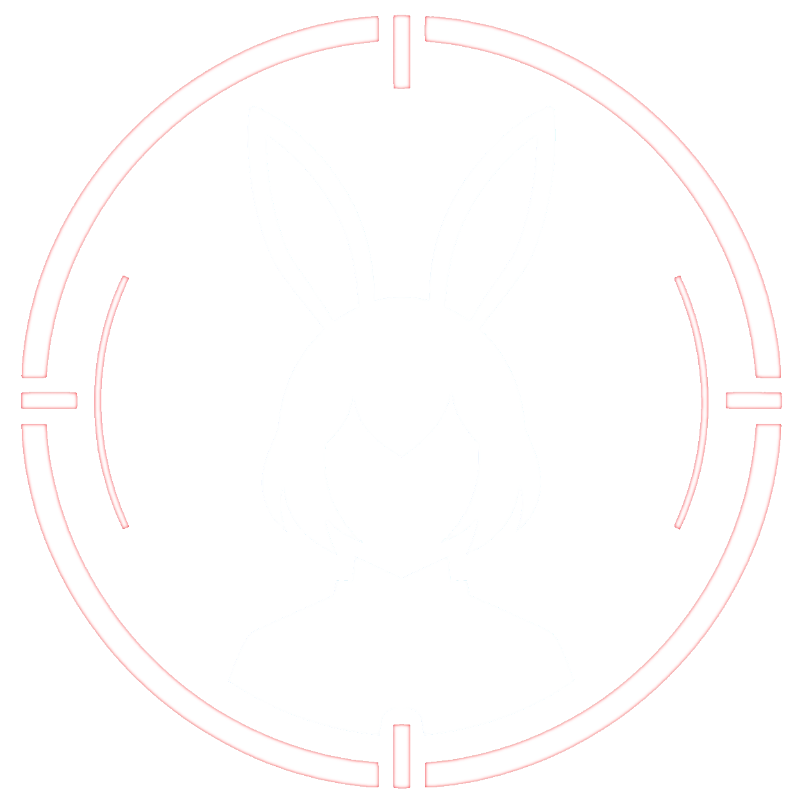

  

# U.N. Avatar

U.N. Avatar は VRM(0/1) と VRC / Unity アバターを、配信向けに軽快に表示する仮想アバターレンダラーです。U.N. Motion や VMC 対応アプリから姿勢・表情・手指を受け取り、透過ウィンドウ、Spout2、スクリーンショットなどで出力できます。

[公式サイト](https://usagi.github.io/un-avatar/) · [Windows版をダウンロード](https://github.com/usagi/un-avatar/releases/latest) · [操作ガイド](docs/operation-guide.md)

## 配信で使う

1. Windows版ZIPをすべて展開し、`un-avatar-supervisor.exe` を起動します。
2. 「プロファイルと稼働」で使うプロファイルを選び、アバターの `.vrm` または `.unavatar` を指定してRendererを起動します。
3. U.N. MotionやVMC対応アプリから動きを送り、OBSにSpout2またはウィンドウで取り込みます。

Unityの衣装や小物も配信で使えます。U.N. Avatar Exporterでアバターを書き出し、Wardrobeに登録した衣装を配信中に切り替えられます。[Exporterの導入と着替えの手順](docs/v2-getting-started.md)

## 使い方を調べる

[動作環境](docs/operation-guide.md#対応環境) · [複数アバターの運用と設定保存](docs/operation-guide.md#複数プロファイルrenderer-を使う場合) · [更新とバックアップ](docs/update-and-recovery.md) · [ドキュメント一覧](docs/README.md)

## Acknowledgements

U.N. Avatar の toon rendering、material compatibility、Wardrobe / avatar assembly behavior は独立した Rust / wgpu / WGSL / Unity Exporter 実装ですが、互換性検証と behavior の理解にあたり、MIT License で公開されている次の先行プロジェクトを重要な参考実装として扱います。

- [lilToon](https://github.com/lilxyzw/lilToon): UNToon v2 / lilToon-compatible rendering の主要な参考実装
- [MToon](https://github.com/Santarh/MToon): VRM / MToon material compatibility の参考実装
- [Modular Avatar](https://github.com/bdunderscore/modular-avatar): `.unavatar` Wardrobe / MergeArmature / BoneProxy / ObjectToggle behavior の主要な参考実装

これらの project 名は互換性の説明と謝辞のために記載しています。U.N. Avatar は各 project の公式派生物または公式実装ではありません。

## License

[MIT](LICENSE)

Third-party components keep their own licenses. See [docs/third-party-licenses.md](docs/third-party-licenses.md).

## Author

[usagi / USAGI.NETWORK](https://usagi.network)
